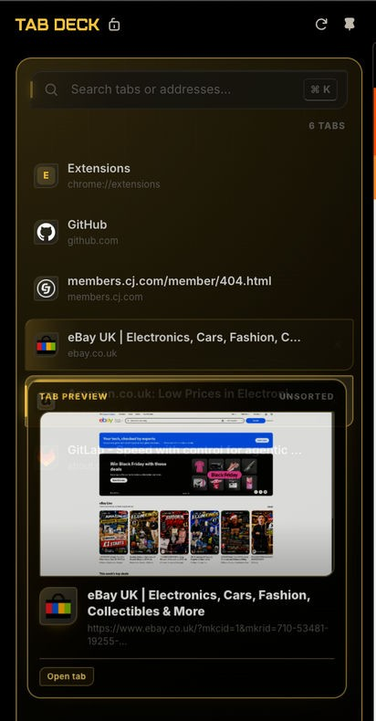
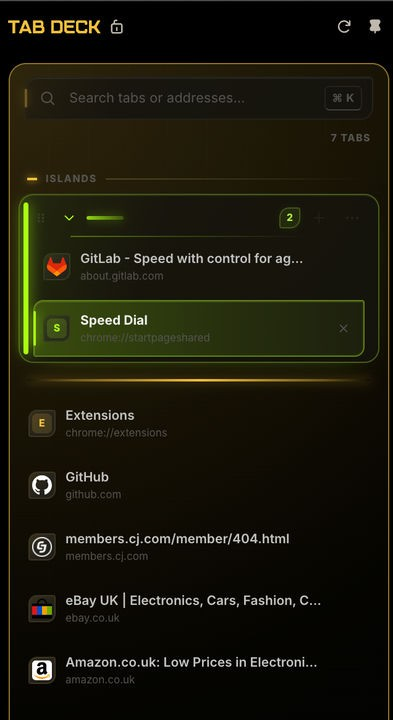
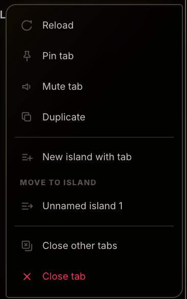
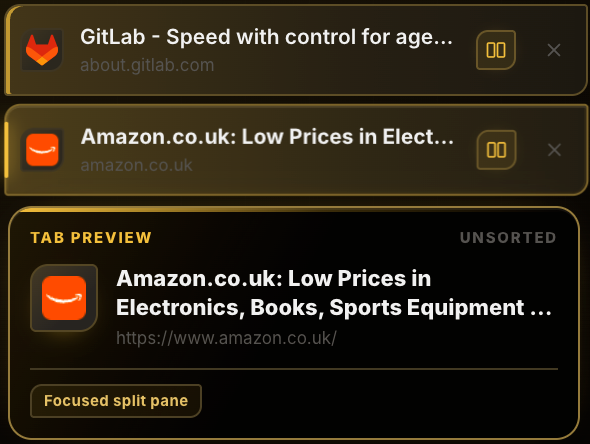
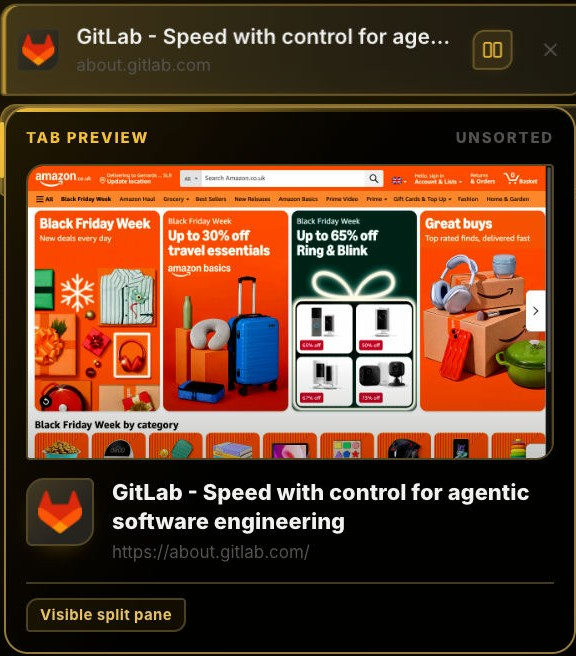
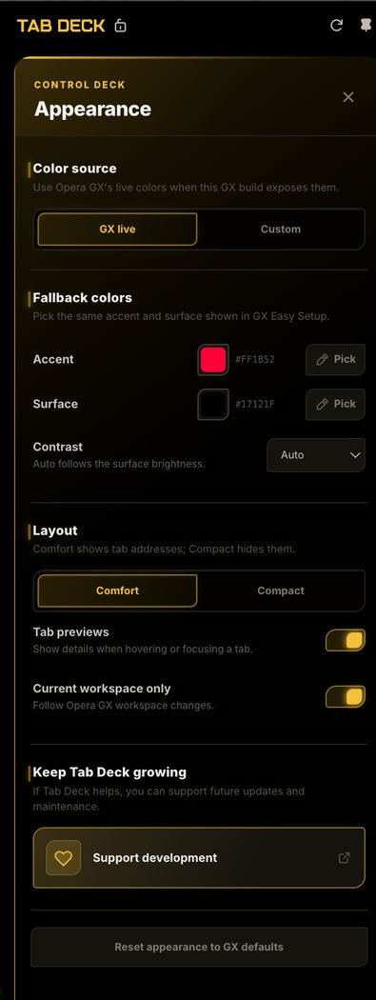
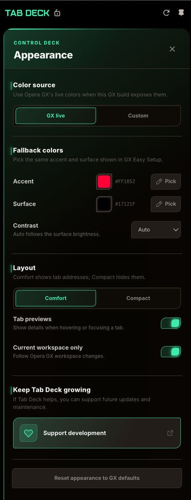
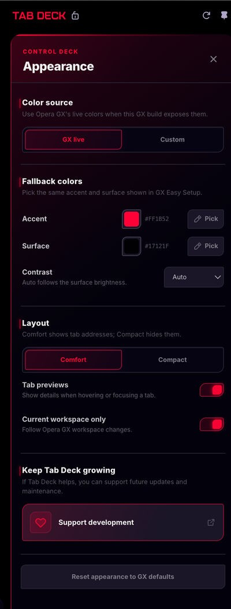

# Tab Deck

Vertical tabs for Opera GX.

Tab Deck adds a searchable vertical tab manager to the Opera GX sidebar. Tabs can be organized into color-coded islands, reordered with drag and drop, previewed on hover, and managed without leaving the sidebar.

  

## Features

- Vertical list of tabs in the Opera GX sidebar
- Instant search by tab title or address
- Color-coded tab islands with custom names
- Native Opera tab-group synchronization where supported
- Drag-and-drop tab and island reordering
- Separate pinned-tab section
- Active-tab, split-screen, audio, muted, loading, and sleeping indicators
- Tab actions for reload, pin, mute, duplicate, move, and close
- Island actions for creating tabs, renaming, recoloring, collapsing, removing, and closing
- Hover and keyboard-focus previews with locally captured thumbnails where Opera permits them
- Current-workspace filtering
- Comfortable and compact layouts
- Live Opera GX colors with custom accent and surface fallbacks
- Automatic, dark, and light contrast modes
- Eyedropper support for matching custom colors to the browser
- Animated tab opening, closing, and hover states
- Keyboard-accessible controls and reduced-motion support
- Local-only tab organization and appearance settings

## Install in Opera GX

1. Open the [latest release](../../releases/latest).
2. Download the extension ZIP attached to the release.
3. Extract the ZIP to a permanent folder.
4. Open `opera://extensions` in Opera GX.
5. Enable **Developer mode**.
6. Select **Load unpacked**.
7. Choose the extracted folder containing `manifest.json`.
8. Open the Opera GX sidebar setup and enable **Tab Deck**.
9. Select the Tab Deck icon in the sidebar.

## Using Tab Deck

### Search tabs

Use the search field at the top of the sidebar. Search matches both tab titles and addresses. Press `Ctrl K` on Windows/Linux or `⌘ K` on macOS to focus the search field.

### Create and manage islands

- Select the island button in the footer to create an island from the active tab.
- Select an island name to rename it.
- Use the arrow beside an island to collapse or expand it.
- Drag a tab into an island or back into the ungrouped section.
- Drag an island by its grip to reorder it.
- Open an island's menu to change its color or perform additional actions.

Pinned tabs remain outside islands and appear in their own section.

  

### Manage tabs

- Select a tab to activate it.
- Use the close button to close it.
- Right-click a tab for reload, pin, mute, duplicate, island, and close actions.
- Drag tabs to change their order.
- Audio and split-screen indicators appear when applicable.

  

### Preview tabs

Hover over or focus a tab to see its title, address, state, and locally captured page thumbnail when one is available. Split-screen tabs identify the focused or visible pane directly in the preview.

<table>
  <tr>
    <td width="50%" valign="top">
      
    </td>
    <td width="50%" valign="top">
      
    </td>
  </tr>
  <tr>
    <td align="center">Tab details and split-pane state</td>
    <td align="center">Locally captured page thumbnail</td>
  </tr>
</table>

### Customize appearance

Open the settings button in the footer to configure:

- Opera GX live colors or custom colors
- Automatic, dark, or light contrast
- Comfortable or compact tab density
- Tab previews
- Current-workspace filtering

The interface follows the active GX accent when available, while custom colors let it match the rest of your browser setup.

  
  
  

